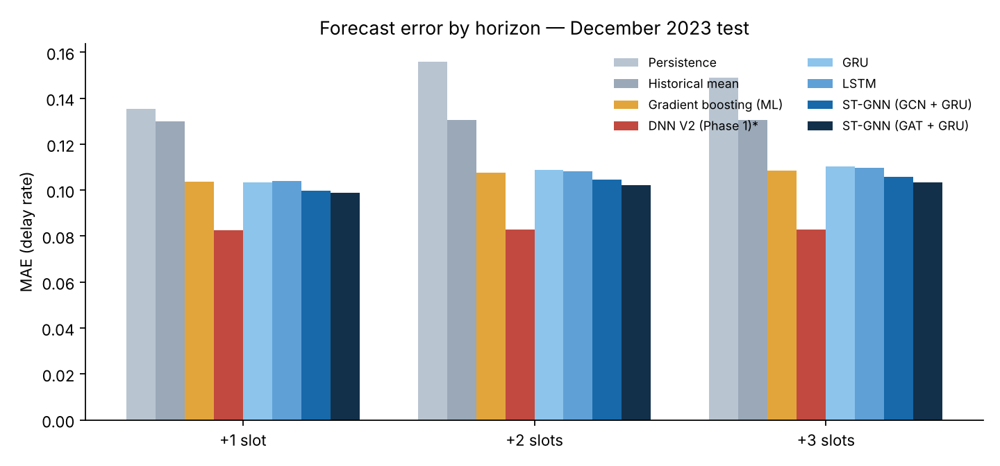
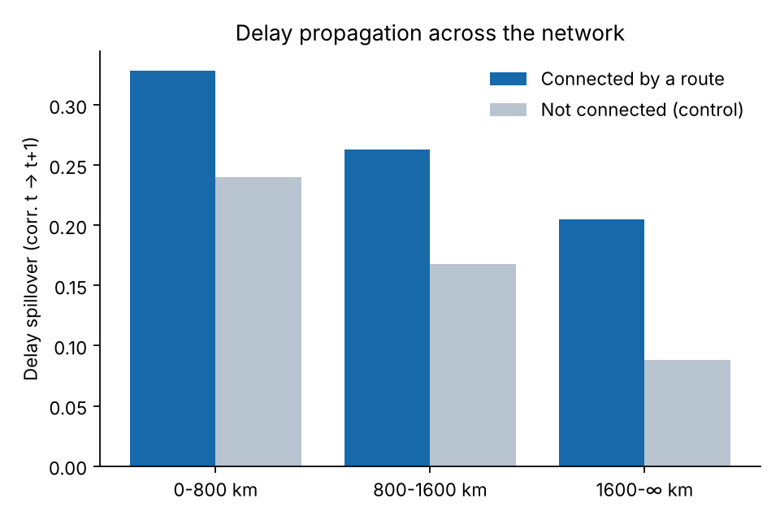

# AeroPredict: Flight Delay Risk Classification & Regression Dashboard

AeroPredict is an end-to-end, industrial-grade **Big Data & Artificial Intelligence** application designed to predict flight delays, assess delay risk probabilities, and estimate exact late arrival times (in minutes). Its primary engine is a **multi-task Deep Neural Network (PyTorch)** trained on half of the 6.7M-flight 2023 dataset, with optional **PySpark MLlib GBT** and **Scikit-Learn** fallbacks. The web dashboard is built with **Flask**, **MongoDB**, and **Plotly**.

This project was developed as a final course project for **Big Data Visualization and Data Analytics (Semester 6)**
and extended in **Phase 2 (Deep Learning)** into **AeroPredict 2.0** — a spatio-temporal graph neural network that
forecasts disruption across the whole US airport network.

---

## 🚦 Start here (summary)

### Quick start — run the app (no training needed)

All models are already trained and included. On Windows (PowerShell), from the project folder:

```powershell
python -m venv venv
venv\Scripts\activate
pip install -r requirements.txt
pip install torch --index-url https://download.pytorch.org/whl/cpu
python run_app.py
```

Open **http://127.0.0.1:5000/**. The terminal should show:

```
ACTIVE MODEL : DNN V2 (PyTorch)
Network model loaded: ST-GNN (GCN + GRU) (47,818 parameters, 350 airports)
```

> The CPU build of PyTorch (~130 MB) is enough to run everything. A GPU build is only useful for retraining.
> MongoDB is optional — without it the app works but the History page stays empty.

### Features — status and where to find them

| # | Feature | Status | Where in the app | Code |
| :-- | :--- | :---: | :--- | :--- |
| 1 | Weather-aware flight delay prediction (live Open-Meteo forecast, 15 days) | ✅ | Flight Prediction → *Flight conditions* panel | `core/weather_api.py`, `core/dnn_features_v2.py` |
| 2 | Deep learning (multi-task DNN) — delay classification **and** delay minutes | ✅ | Flight Prediction → result card | `core/dnn_common.py`, `training/phase1_dnn/` |
| 3 | Airport-level disruption forecasting with **LSTM / GRU** | ✅ | Network → *How the models compare* | `core/st_models.py` (`TemporalRNN`) |
| 4 | Airport network graph — 350 airports (nodes), 6,576 routes (edges) | ✅ | Network → map (route lines) | `training/phase2_st_gnn/build_graph.py` |
| 5 | **Spatio-Temporal GNN** (GCN or GAT + GRU) with 95 % uncertainty bands | ✅ | Network → map, warnings, simulator | `core/st_models.py` (`STGNN`) |
| 6 | Delay propagation analysis across connected airports | ✅ | Network → *Delay propagation* | `training/phase2_st_gnn/propagation_analysis.py` |
| 7 | Interactive airport disruption map with **+1 / +2 / +3 slot** forecasts | ✅ | Network → *Forecast delay rate* + *Bottleneck warnings* | `webapp/templates/network.html`, `core/st_inference.py` |
| 8 | What-if simulators — network disruption **and** departure-time what-if | ✅ | Network → *What-if simulator* · Flight Prediction → *What if you fly at a different time?* | `core/st_inference.py`, `webapp/flask_app.py` |
| 9 | Model comparison: ML vs DNN vs LSTM/GRU vs ST-GNN (ablation study) | ✅ | Network → *How the models compare* | `evaluation/run_ablation.py` |
| 10 | All of the above integrated into the AeroPredict web app | ✅ | Navigation → **Network** tab | `webapp/` |

### Trained models — files and which feature uses them

| Model | File | Used by features | Status |
| :--- | :--- | :--- | :--- |
| **DNN V2** (embeddings + 512→256→128, two heads) | `models/dnn_v2/dnn_v2_model.pt` | 1, 2, 8 (departure-time what-if), 9 (as "Model 2") | ✅ trained — serves Flight Prediction |
| DNN V1 (baseline MLP) | `models/dnn_v1/dnn_model.pt` | 2 — backup only if DNN V2 is missing | ✅ trained |
| SVM + Gradient-Boosting regressor (Semester 6) | `models/classic_ml/` | 1, 2 — backup only if no DNN loads | ✅ trained |
| **ST-GNN (GCN + GRU)** | `models/st_gnn/st_gnn_model.pt` | 5, 6 (model footprint), 7, 8 (network simulator), 9 | ✅ trained — serves the Network page |
| ST-GNN (GAT + GRU) | `models/st_gnn/st_gnn_gat_model.pt` | 5, 9 | ✅ trained — comparison table |
| GRU (temporal only) | `models/temporal/gru_model.pt` | 3, 9 | ✅ trained — comparison table |
| LSTM (temporal only) | `models/temporal/lstm_model.pt` | 3, 9 | ✅ trained — comparison table |
| Gradient boosting (ablation baseline) | — (re-fitted in ~15 s each run) | 9 (as "Model 1") | ✅ built by `evaluation/run_ablation.py` |

Features 4 and 6 (measured side) are data analyses, not trained models: `build_graph.py` creates the graph and
`propagation_analysis.py` produces the statistics. All Phase 2 models were trained to early stopping (best validation epoch kept).

### What each page shows

| Page | What it does |
| :--- | :--- |
| **Overview** `/` | 3D aircraft hero, network statistics (6.74 M flights, 349 airports, 15 airlines) and shortcuts |
| **Flight Prediction** `/predict-page` | Enter route, date, time, airline → delay probability, risk level, estimated delay minutes, auto-filled weather, departure-time what-if |
| **Network** `/network` | AeroPredict 2.0: disruption map (+1/+2/+3 slots), bottleneck warnings with 95 % bands, delay propagation, what-if simulator, model comparison |
| **Analytics** `/visualizations` | Seven Plotly charts of 2023 delay patterns (seasonality, airlines, weather, airport map) |
| **History** `/history` | Every prediction made, with search and risk filter (needs MongoDB) |
| **Settings** `/settings` | Service status, model details, display preferences |

> **The Network page is a historical replay of December 2023** — the held-out test month no model was trained on.
> It opens on **10 Dec 2023** (a major East-Coast storm). Pick any 2023 date/slot and press *Run forecast*; hover an
> airport to compare the forecast with what actually happened. It is not a live feed (the data ends 31 Dec 2023).

### Headline results (December 2023 test)

| Model | Graph | Temporal | MAE +1 slot | MAE +2 | MAE +3 |
| :--- | :---: | :---: | ---: | ---: | ---: |
| **ST-GNN (GAT + GRU)** | ✓ | ✓ | **0.099** | **0.102** | **0.103** |
| ST-GNN (GCN + GRU) | ✓ | ✓ | 0.100 | 0.105 | 0.106 |
| Gradient boosting (ML) | ✗ | lag features | 0.104 | 0.108 | 0.108 |
| GRU | ✗ | ✓ | 0.103 | 0.109 | 0.110 |
| LSTM | ✗ | ✓ | 0.104 | 0.108 | 0.110 |

* Adding the airport graph lowers error by 3–6 % versus time-only models, more at longer horizons.
* Airports connected by a route show **0.26** next-slot delay correlation vs **0.16** for unconnected pairs at the same distance (p < 10⁻⁹⁵).
* DNN V2 (flight-level, Phase 1): **84.4 %** accuracy, AUC **0.80**, delay MAE **35.8 min**.
* Full table, PR-AUC/F1 and charts: [Phase 2 results](#results--december-2023-test-forecast-airport-delay-rate-123-slots) and `evaluation/`.

### Data — what is in the repository

| Included in git | Not in git (share separately, e.g. Google Drive) |
| :--- | :--- |
| All trained models (`models/`) | `data/processed/preprocessed_flight_data_final.csv` (1.1 GB) |
| Airport graph + propagation results (`data/graph/`) | Raw 2023 CSVs in `data/raw/` (US_flights_2023, weather, cancellations) |
| Lookup tables, weather calibration (`data/lookups/`, `data/weather/`) | `venv/` |
| Results tables and charts (`evaluation/`) | |

The app and every page run from what is in git. The large CSVs are needed only to **rebuild the graph or retrain**.

### Known limitations (stated honestly)

* The processed 2023 file has **no departure hour** — one time step is a slot (Morning 06–12, Afternoon 12–18,
  Evening 18–22, Night 22–06), so forecasts are for the next 1/2/3 **slots** (~6 h each), not hours.
* It has **no delay minutes or aircraft tail numbers** — Phase 2 forecasts an airport's **delay rate**, and
  propagation is measured **between connected airports**, not along individual aircraft rotations.
* For disruption **alerts** gradient boosting is marginally ahead (PR-AUC 0.318 vs 0.308 for the ST-GNN).
* DNN V2's score in the ablation table is **in-sample** (Phase 1 trained it on a random 95 % of all 2023 flights).
* Not a live flight tracker: predictions run in real time and weather is live for the next 15 days, but delay
  patterns come from 2023 data.

### Retrain everything (optional)

Needs `data/processed/preprocessed_flight_data_final.csv`. A GPU is used automatically if PyTorch has CUDA.

```powershell
python training\phase2_st_gnn\build_graph.py                              # airport graph, ~30 s
python training\phase2_st_gnn\train_spatiotemporal.py --model stgnn_gcn   # ST-GNN (served by the app)
python training\phase2_st_gnn\train_spatiotemporal.py --model stgnn_gat   # ST-GNN with attention
python training\phase2_st_gnn\train_spatiotemporal.py --model gru         # temporal baseline
python training\phase2_st_gnn\train_spatiotemporal.py --model lstm        # temporal baseline
python training\phase2_st_gnn\propagation_analysis.py                     # propagation statistics
python evaluation\run_ablation.py                                          # comparison table + charts
```

Phase 1 DNN retraining needs the raw `US_flights_2023.csv` in `data/raw/` — see [How to Run](#-how-to-run).

### Working on a branch (collaborators)

```powershell
git checkout -b <your-branch-name>
git add -A
git commit -m "describe your change"
git push -u origin <your-branch-name>
```

Then open a Pull Request on GitHub into `main`. To try someone's branch:
`git fetch origin` then `git checkout <their-branch-name>`.

---

## 🏗️ System Architecture

The following diagram outlines the data flow from raw storage to the real-time user interface:

```
                  +----------------------------------------------+
                  |  RAW DATASETS (6.5 Million Records in HDFS)  |
                  |  - US_flights_2023.csv (1.1 GB)              |
                  |  - weather_meteo_by_airport.csv (Daily)      |
                  |  - Cancelled_Diverted_2023.csv (Exclusions)  |
                  |  - airports_geolocation.csv (GPS coords)     |
                  +----------------------------------------------+
                                         |
                                         v
                  +----------------------------------------------+
                  |     Apache Spark Distributed ETL Engine      |
                  |     - Removes cancelled/diverted flights     |
                  |     - Attaches airport geolocations          |
                  |     - Joins weather variables on date+airport|
                  |     - Natively imputes missing sensor data   |
                  +----------------------------------------------+
                                    /            \
                                   /              \
                                  v                v
       +--------------------------------------+  +-------------------------------------+
       |  DNN V2 - PyTorch (PRIMARY)          |  |  CLASSIC FALLBACKS                  |
       |  - Embeddings + 34 features, 100%    |  |  - GBT Classifier (Spark MLlib)     |
       |  - Head 1: delay probability (>15m)  |  |  - Linear SVM (scikit-learn)        |
       |  - Head 2: delay minutes             |  |  - GBT Regressor (scikit-learn)     |
       +--------------------------------------+  +-------------------------------------+
                                 \                /
                                  \              /
                                   v            v
                  +----------------------------------------------+
                  |            Flask Premium Frontend            |
                  |   - /predict-page: User enters flight data   |
                  |     (Autofills weather & flight metrics)     |
                  |   - /visualizations: Plotly analytics        |
                  |   - Settings: model info (DNN / fallback)    |
                  +----------------------------------------------+
                                         |
                                         v
                  +----------------------------------------------+
                  |            MongoDB Logging System            |
                  |   - Stores all runtime predictions in DB     |
                  |   - Collection: aeropredict.predictions      |
                  +----------------------------------------------+
```

---

## 📊 Core Project Statistics

Below are the key figures and performance metrics computed on the flight logs:

| Metric | Value | Meaning / Context |
| :--- | :--- | :--- |
| **Total Raw Records** | **6.5 Million** flights | Total US domestic flights processed through HDFS. |
| **Cleaned Dataset** | **1.96 Million** flights | Count after filtering cancellations, diversions, and duplicates. |
| **HDFS Target Directory** | `hdfs://localhost:9000/flight_project/` | Active Hadoop Distributed File System repository. |
| **Spark partitions** | **16 Partitions** | The scale of parallel execution chunks across the cluster. |
| **Spark ETL Run Time** | **~16 seconds** | Time Spark takes to join, clean, and impute 6.5M rows. |
| **DNN V2 Training Rows** | **6.41 Million** flights | Every valid row of the 2023 dataset (100%, no sampling). |
| **DNN V2 Accuracy** | **84.40%** | Delay classification accuracy on a 168,586-flight holdout. |
| **Risk Thresholds** | **Low ($\le$ 25%), Med (25% - 40%), High ($\ge$ 40%)** | Delay probability brackets. |
| **MongoDB Port** | **27017** | Database connection port for runtime auditing. |

---

## 🏁 ML vs DL Model Comparison

Three engines are kept in the repository so the classic **Machine Learning**
baseline and both **Deep Learning** generations can be compared side by side.

### Classification — predicting a delay > 15 minutes

| | **Classic ML (Spark MLlib GBT + SVM)** | **DNN V1 (50% data)** | **DNN V2 (100% data)** |
| :--- | :--- | :--- | :--- |
| **Accuracy** | 80.88% | 81.44% | **84.40%** |
| **AUC-ROC** | — (not recorded) | 0.7306 | **0.7996** |
| **Precision @0.5** | — (not recorded) | 64.69% | **78.80%** |
| **Recall @0.5** | — (not recorded) | 14.39% | **29.37%** |
| **F1 @0.5** | — (not recorded) | 23.55% | **42.79%** |
| **Training data** | 1.96M cleaned flights | 3.37M (50% sample) | **6.41M (100%)** |
| **Features** | 14 | 36 (14 num + 22 one-hot) | **34 num + 5 embeddings** |
| **Parameters** | — | 51,522 | 219,718 |
| **Runtime requirement** | Spark + Hadoop + Java | CPU-only PyTorch | CPU-only PyTorch |

### Regression — estimating delay length in minutes

| | **Classic ML (GBR)** | **DNN V1** | **DNN V2** |
| :--- | :--- | :--- | :--- |
| **MAE** | ~18.2 min* | 37.38 min | **35.80 min** |
| **RMSE** | — | 63.08 min | **61.54 min** |
| **R²** | — | −0.039 | **+0.017** |
| **MAE (all flights)** | — | 48.65 min | 49.23 min |
| **Scored on** | delayed + on-time mix* | delayed only | delayed only |

\* The baseline's ~18.2 min was reported on a *mixed* subset where ~80% of rows
are near-zero and easy to predict, so it is **not comparable** to the delayed-only
numbers. On the same "all flights" basis V2 scores 49.23 min. Delay duration is
inherently noisy — most of it is not explainable from data available at booking
time.

### DNN V2 risk-tier behaviour (the cut-offs the app actually uses)

| Tier | Threshold | % of test flights flagged | Precision | Recall | F1 |
| :--- | :--- | :--- | :--- | :--- | :--- |
| **Medium+High** | P ≥ 25% | 20.68% | 52.55% | 54.71% | 0.536 |
| **High** | P ≥ 40% | 10.73% | 69.33% | 37.45% | 0.486 |
| (reference) | P ≥ 50% | 7.40% | 78.80% | 29.37% | 0.428 |

Mean predicted probability on the test split was **18.18%** vs **19.87%** of
flights actually delayed — the classification head is well calibrated, so the
same tier cut-offs mean the same thing in the UI as they do in the metrics.

### What V2's preprocessing buys (controlled ablation)

Same 10% of the data, same 8 epochs, only the preprocessing/architecture changed:

| | DNN V1 pipeline | DNN V2 pipeline | Gain |
| :--- | :--- | :--- | :--- |
| AUC-ROC | 0.7106 | **0.7753** | **+0.065** |
| Accuracy | 80.83% | **84.02%** | **+3.2 pts** |
| Delay MAE | 38.03 min | **36.83 min** | −1.2 min |

### DNN V2 preprocessing pipeline

| Step | What it does |
| :--- | :--- |
| **Categorical embeddings** | Airline, departure airport, arrival airport, departure slot and haul type become learned vectors (8/16/16/4/3 dims) instead of 351 near-empty one-hot columns |
| **Arrival-side context** | Adds arrival-airport weather (`tavg`, `prcp`, `wspd`, `pres`) and coordinates — V1 only knew the departure airport |
| **Great-circle distance** | Haversine dep→arr in km (0–8,200), replacing the coarse 3-level haul bucket as a numeric signal |
| **Cyclical calendar** | Month, day-of-year and day-of-week as sin/cos pairs, so 31 Dec and 1 Jan are adjacent |
| **Smoothed target encodings** | Departure-airport, arrival-airport, airline, **route**, **airport × slot**, airline × slot and **airport × month** delay rates, Bayesian-smoothed `(sum + prior·k)/(count + k)`; fitted on training rows only so the test split never leaks |
| **Volume features** | `log1p(flights on that route)`, `log1p(flights from that airport that day)` for congestion pressure |
| **Robust scaling** | Clip each numeric feature to the train p0.1–p99.9 range, then standardise — one 571 mm rain day or a 57-year-old aircraft can no longer dominate |
| **Route facts for serving** | Observed median `Flight_Duration` + haul label per route (6,586 routes) are stored in the preprocessor, so the web app no longer guesses them with a crude distance formula |

Leakage audit: the strongest correlation between any engineered feature and the
target is `route_rate` at **|r| = 0.21**, which is healthy signal rather than leakage.

### DNN V2 training run (reproducible)

| Setting | Value |
| :--- | :--- |
| Data | `--sample-frac 1.0` → **6,743,404 rows** (19.87% delayed) |
| Split | 6,406,233 train / 168,585 val / 168,586 test (stratified) |
| Architecture | 34 numeric + embeddings `8/16/16/4/3` → 81 dims → 512 → 256 → 128 → 2 heads |
| Parameters | 219,718 |
| Epochs | 12 (best epoch 11) |
| Optimiser | AdamW lr 2.5e-3, `ReduceLROnPlateau`, batch 16,384, grad-clip 5.0 |
| Loss | BCE (classification) + 0.5 × SmoothL1 (regression, delayed rows only) |
| Duration | 6,070 s (~101 min) on 12 CPU threads |
| Command | `python training/phase1_dnn/train_dnn_v2.py` |

### DNN V1 training run (previous baseline)

| Setting | Value |
| :--- | :--- |
| Sample | `--sample-frac 0.5` → 3,371,702 rows (19.86% delayed) |
| Split | 2,697,361 train / 337,170 val / 337,171 test (stratified) |
| Architecture | 36 → 256 → 128 → 64 → 2 heads, 51,522 parameters |
| Epochs | 15 / 15 (best epoch = 15, still improving, no early stop) |
| Optimiser | AdamW, lr 1e-3, `ReduceLROnPlateau`, batch 8192 |
| Duration | 754 s (~12.6 min) on 12 CPU threads |
| Command | `python training/phase1_dnn/train_dnn.py --sample-frac 0.5 --epochs 15` |

---

## 🧠 Key Features

### 1. Multi-Task Deep Learning (primary) + Classic Fallbacks
- **DNN V2 (PyTorch, primary)**: trained on the **full 6.7M-flight 2023 dataset**. Categorical fields (airline, both airports, departure slot, haul type) enter as **learned embeddings**, alongside 34 numeric features — departure *and* arrival airport weather, great-circle distance, cyclical calendar encodings and smoothed per-airport/route/airline delay rates fitted on training rows only. Trunk `512 → 256 → 128` splits into:
  - *Head 1 — classification*: probability the flight arrives more than 15 minutes late.
  - *Head 2 — regression*: estimated arrival delay in minutes (trained on delayed flights only).
  Both outputs come from a single forward pass, so risk and delay minutes are always consistent.
- **DNN V1 (PyTorch, baseline)**: the earlier `36 → 256 → 128 → 64` MLP trained on 50% of the data. Kept in the repo for comparison; used automatically if the V2 artifacts are missing.
- **Tier 3 (fallback)**: If no DNN artifacts exist, the app falls back to the **Spark MLlib GBT classifier** (when `gbt_full_pipeline/` exists) or the local **Scikit-Learn SVM**, plus the **Gradient Boosting Regressor** for delay minutes. Delay minutes are shown when the risk is **Medium** or **High**.

### 2. Live Interactive Visualizations
A dedicated dashboard rendering live interactive Plotly charts, including:
- **Geospatial Delay Hotspots**: An interactive maps dashboard displaying North American airport flight nodes colored by delay frequency.
- **Delay Heatmap**: Cross-references departure hours and days of the week to pinpoint peak-delay intervals.
- **Weather Correlation Graph**: Scatter sample mapping temperature and rainfall levels against delay lengths, indicating a strong correlation with precipitation (**16.47% feature importance**).

### 3. Autofill Intelligence
When booking details are entered, Flask fills weather, airport delay history and typical
flight duration automatically. Weather is resolved in this order:

1. **Open-Meteo live forecast** for departures within the next 15 days;
2. **observed airport-day weather** from the training file, for 2023 dates;
3. **2023 monthly climatology** for anything further out.

The panel states which source answered (and the model receives that same value), so a
forecast-driven prediction is never confused with a climatology-driven one.

---

## 🌤 Live Weather (Open-Meteo)

For future departures the app no longer relies only on monthly averages. It asks
[Open-Meteo](https://open-meteo.com/) for a daily forecast at **both** airports and feeds
those values into the DNN, using the same five fields the model was trained on
(temperature, precipitation, wind, pressure, snow).

### Source priority

| # | Source | Used when | What the model receives |
| :--- | :--- | :--- | :--- |
| 1 | **Open-Meteo forecast** | date is within `today .. today+14` | calibrated forecast, injected through `wx_override` |
| 2 | **2023 observed** | date is in 2023 | exact airport-day value from the training file |
| 3 | **2023 monthly climatology** | anything further out, or offline | monthly airport average |

Any network error, timeout, unknown airport or out-of-range date silently falls through
to the next source, so a prediction never fails because of the weather API.

### Why a calibration layer?

The training file (`weather_meteo_by_airport.csv`) and Open-Meteo are **different weather
products**. They agree closely on temperature and pressure, but Open-Meteo's wind is
systematically lower (different averaging height) and its coarser precipitation grid
misses local convective storms. Feeding raw values would land the model outside its
training distribution.

`calibrate_open_meteo.py` therefore fits a per-airport correction
`training_value = a × open_meteo_value + b` against Open-Meteo's **Historical Forecast
Archive for 2023** — the same model family the live endpoint uses — and stores it in
`wx_calibration.json` (364 airports). Snow is fitted globally because the unit mismatch
(~85×) is identical everywhere; per-airport fits are noise.

### Measured value

40,000 held-out 2023 flights, scored through DNN V2 with **only the weather source
changed** (`validate_open_meteo.py`, results in `wx_validation.json`):

| Weather source | AUC-ROC | Accuracy | MAE (delayed) | Mean P |
| :--- | :--- | :--- | :--- | :--- |
| 2023 dataset weather *(upper bound)* | 0.8073 | 84.50% | 34.52 min | 0.185 |
| Monthly climatology *(previous behaviour)* | 0.7860 | 83.68% | 35.27 min | 0.185 |
| Raw Open-Meteo | 0.8053 | 84.47% | 34.78 min | 0.182 |
| **Calibrated Open-Meteo (served)** | **0.8055** | **84.39%** | **34.70 min** | **0.185** |

Calibration recovers almost the entire gap between climatology and reality:
**+0.0195 AUC, +0.71 accuracy points and −0.57 min MAE** versus monthly averages, ending
within **0.002 AUC / 0.18 min MAE** of the true-weather upper bound. The accuracy
difference between raw and calibrated (0.08 pt) is sampling noise; calibrated is better on
AUC and MAE, and it maps wind/rain to the scale the model actually learned.

### Limits and attribution

* Forecast horizon is **15 days** (`today` through `today+14`); Open-Meteo rejects later
  dates with HTTP 400, which the client treats as a normal miss.
* Forecasts are cached for **1 hour**; one batched request covers both airports.
* Free tier: **10,000 requests/day**, no API key, Python standard library only.
* Weather data by **Open-Meteo.com, licensed CC BY 4.0** — the required attribution is
  shown in the page footer and returned with every forecast-driven prediction.

---

## 🌐 AeroPredict 2.0 — Spatio-Temporal Network Model (Phase 2)

Phase 1 predicts a single flight. Phase 2 models the **whole airport network**: delays at one
airport spill over to the airports it connects to, so the network is learned as a graph.

Feature status and model-to-feature mapping: see [Start here](#-start-here-summary).

**Data limits (stated honestly):** the processed 2023 file has no departure hour, no delay minutes
and no aircraft tail number. So one time step is a **slot (≈ 6 h)** — forecasts are for the next
1, 2 and 3 slots rather than 1/2/3 hours — the target is the airport's **delay rate**, and
propagation is measured **between connected airports**, not along individual aircraft rotations.

### Run it (GPU used automatically)

```bash
pip install -r requirements.txt
python training/phase2_st_gnn/build_graph.py                          # ~30 s
python training/phase2_st_gnn/train_spatiotemporal.py --model stgnn_gcn
python training/phase2_st_gnn/train_spatiotemporal.py --model stgnn_gat
python training/phase2_st_gnn/train_spatiotemporal.py --model gru
python training/phase2_st_gnn/train_spatiotemporal.py --model lstm
python training/phase2_st_gnn/propagation_analysis.py
python evaluation/run_ablation.py
python run_app.py                                                     # → Network tab
```

### Results — December 2023 test (forecast airport delay rate, +1/+2/+3 slots)

| Model | Role | Graph | Temporal | MAE +1 | MAE +2 | MAE +3 | RMSE | PR-AUC | Precision | Recall | F1 |
| :--- | :--- | :---: | :---: | ---: | ---: | ---: | ---: | ---: | ---: | ---: | ---: |
| Persistence | baseline | ✗ | last slot | 0.1354 | 0.1559 | 0.1489 | 0.2185 | 0.103 | 0.129 | 0.298 | 0.180 |
| Historical mean | baseline | ✗ | no | 0.1300 | 0.1307 | 0.1306 | 0.1649 | 0.132 | 0.141 | 0.329 | 0.197 |
| Gradient boosting (ML) | Model 1 | ✗ | lag features | 0.1036 | 0.1077 | 0.1084 | 0.1436 | 0.318 | 0.341 | 0.407 | 0.371 |
| DNN V2 (Phase 1)* | Model 2 | ✗ | no | 0.0826 | 0.0828 | 0.0828 | 0.1203 | 0.588 | 0.542 | 0.611 | 0.574 |
| GRU | Model 3 | ✗ | yes | 0.1033 | 0.1090 | 0.1104 | 0.1456 | 0.301 | 0.312 | 0.387 | 0.345 |
| LSTM | Model 3 | ✗ | yes | 0.1039 | 0.1082 | 0.1096 | 0.1457 | 0.283 | 0.293 | 0.383 | 0.332 |
| ST-GNN (GCN + GRU) | Model 4 | ✓ | yes | 0.0998 | 0.1045 | 0.1058 | 0.1428 | 0.308 | 0.325 | 0.388 | 0.354 |
| ST-GNN (GAT + GRU) | Model 4 | ✓ | yes | 0.0989 | 0.1022 | 0.1032 | 0.1443 | 0.284 | 0.311 | 0.382 | 0.343 |

* DNN V2 was trained in Phase 1 on a random 95 % of all 2023 flights, so it has seen most December flights — its score here is optimistic (in-sample).

MAE is in delay-rate units (0.10 = 10 percentage points). Disruption = a slot with ≥ 5 departures
and ≥ 40 % delayed. All models trained to early stopping (best validation epoch kept); retrain with the
commands above to reproduce; `evaluation/run_ablation.py` regenerates this table.

* Among models that never saw the test month, the **ST-GNNs have the lowest error at every
  horizon**; adding the graph beats the temporal-only GRU/LSTM by 3–6 %, more at longer horizons.
* For disruption *alerts*, gradient boosting is marginally ahead (PR-AUC 0.318 vs 0.308) — the
  ST-GNN is trained for the delay rate, not for the alert threshold.
* Every ST-GNN forecast carries a 95 % band; on the test month the bands contain the observed
  rate ≈ 94–95 % of the time (well calibrated).



### Delay propagation finding

Across **3,774 busy routes**, the delay surprise at an airport in slot *t* correlates **0.26** with the destination's surprise in slot *t + 1*, against **0.16** for airport pairs with no direct route (Mann-Whitney p < 10⁻⁹⁵ in every distance band). The gap holds at every distance, so it is not just regional weather:

| Distance | Connected | Not connected | Extra delay after a disruption (connected) |
| :--- | ---: | ---: | ---: |
| 0-800 km | 0.328 | 0.240 | +9.8 pp |
| 800-1600 km | 0.263 | 0.168 | +6.5 pp |
| 1600-∞ km | 0.205 | 0.088 | +3.5 pp |



---

## 📁 Repository Structure

> Full file-by-file map: [`PROJECT_STRUCTURE.md`](PROJECT_STRUCTURE.md). Every folder also has its own short `README.md`.

```
AeroPredict/
├── run_app.py              ← start the website:  python run_app.py
├── PROJECT_STRUCTURE.md    ← where every file lives
├── README.md · LICENSE · requirements.txt · .gitignore
│
├── webapp/                 Flask website (flask_app.py, templates/, static/)
├── core/                   Shared code: project_paths.py, dnn_*.py, weather_api.py, st_data/st_models/st_inference.py
│
├── data/
│   ├── raw/                2023 flight, weather, cancellation, airport CSVs (large ones not in git)
│   ├── processed/          cleaned / merged datasets
│   ├── lookups/            airport coords, airport delay rates, weather averages (needed at startup)
│   ├── weather/            wx_calibration.json, wx_validation.json
│   └── graph/              Phase 2: airport graph + hourly series
│
├── models/
│   ├── dnn_v2/             Phase 1 primary DNN (served by the app)
│   ├── dnn_v1/             Phase 1 baseline DNN
│   ├── classic_ml/         Semester 6 SVM / GBT / regressor
│   ├── st_gnn/             Phase 2 ST-GNN checkpoints (GCN, GAT)
│   └── temporal/           Phase 2 GRU / LSTM baselines
│
├── training/
│   ├── phase1_dnn/         train_dnn_v2.py, train_dnn.py
│   ├── phase2_st_gnn/      Phase 2: build_graph.py, train_spatiotemporal.py, propagation_analysis.py
│   └── legacy_sem6/        Spark/HDFS + scikit-learn scripts from Semester 6
│
├── tools/                  weather_calibration/, lookups/
├── evaluation/             Phase 2 ablation study: run_ablation.py, results/, figures/
├── database/               Phase 2 PostgreSQL logging
└── docs/                   phase2_blueprint/next_steps.pdf, reports
```

---

## 🛠️ Installation & Setup

### 1. Prerequisites
Ensure you have the following installed on your machine:
- **Python 3.10+**
- **MongoDB** (optional — runs on port `27017` for prediction history)
- *Optional:* **Java JDK 8/11 + Apache Spark 3.5.x** only if you want to run the legacy GBT pipeline. The DNN and the Flask app run without Spark/Hadoop.

### 2. Environment Setup
1. Clone this repository:
   ```bash
   git clone https://github.com/Dhruv-D-18/AeroPredict.git
   cd AeroPredict
   ```

2. Create a virtual environment and install python dependencies:
   ```bash
   python -m venv venv
   venv\Scripts\activate            # macOS/Linux: source venv/bin/activate
   pip install -r requirements.txt
   pip install torch --index-url https://download.pytorch.org/whl/cpu   # CPU PyTorch (enough to run)
   ```

3. *(Optional — legacy Spark GBT only)* declare Hadoop/PySpark paths:
   ```powershell
   $env:SPARK_HOME="C:\path\to\spark-3.5.x-bin-hadoop3"
   $env:PATH="$env:SPARK_HOME\bin;$env:PATH"
   ```

### 3. Database Initialization (Optional)
Ensure a local instance of MongoDB is running:
```bash
# Test connection via CLI or MongoDB Compass
mongosh "mongodb://localhost:27017"
```
*Note: Flask connects automatically. If MongoDB is offline, Flask will display a warning in the console and continue predicting in offline mode, bypassing database logs.*

---

## Pictures

<p align="center">
  
  
</p>
<p align="center">
  
  
</p>


## 🚀 How to Run

### 1. Model Training
*Note: Pre-trained DNN, SVM and Regressor artifacts are included, so the app starts immediately. To re-train:*

- **Train the V2 multi-task DNN (primary, full dataset, no Spark needed)**:
  ```bash
  python training/phase1_dnn/train_dnn_v2.py           # 100% of rows, 12 epochs
  python training/phase1_dnn/train_dnn_v2.py --sample-frac 0.02     # quick smoke test
  ```
  Writes `models/dnn_v2/dnn_v2_model.pt`, `dnn_v2_preprocessor.pkl`, `dnn_v2_metrics.json`.
  The app picks V2 up automatically; V1 is used only if V2 artifacts are absent.

- **Train the V1 DNN baseline (50% sample, for comparison)**:
  ```bash
  python training/phase1_dnn/train_dnn.py --sample-frac 0.5 --epochs 15
  ```
  Writes `models/dnn_v1/dnn_model.pt`, `dnn_preprocessor.pkl`, `dnn_metrics.json`.

- **Optional legacy fallbacks**:
  ```bash
  python training/legacy_sem6/make_gbt_flask_pipeline.py   # Spark GBT pipeline
  python training/legacy_sem6/train_model.py               # Spark GBT + SVM pickle
  python training/legacy_sem6/train_regressor.py           # sklearn GBT regressor
  ```

### 2. Start the Web Dashboard
The DNN runs on CPU, so plain Python is enough, and the app can be launched
from any directory:
```bash
python run_app.py
```
Then open:
```
http://127.0.0.1:5000/
```

On startup the app prints exactly which model it is serving, e.g.:

```
------------------------------------------------------------------
  ACTIVE MODEL : DNN V2 (PyTorch)
  Test accuracy: 84.40%   AUC: 0.7996
  Delay MAE    : 35.8 min (delayed flights)
  Trained on   : 6,406,233 flights (100% of 6,743,404)
  Parameters   : 219,718   numeric features: 34
  Weather      : Open-Meteo forecast 2026-11-05 .. 2026-11-19 (calibrated for 364 airports)
------------------------------------------------------------------
```

Model selection is automatic at import time:
`models/dnn_v2/` → `models/dnn_v1/` →
Spark GBT pipeline (only if `models/classic_ml/gbt_full_pipeline/` exists) → SVM.
The Network page loads `models/st_gnn/st_gnn_model.pt` (falls back to GAT, then GRU/LSTM).
No Spark, Hadoop or Java is needed for the DNN path.

### 3. Weather Calibration (one-off, optional)
The app ships with `data/weather/wx_calibration.json`, so live forecasts work out of the box.
Re-run this only if you change the training weather file or want to refresh the
correction against a newer Open-Meteo archive:

```bash
python tools/weather_calibration/calibrate_open_meteo.py            # ~18 archive requests, resumable
python tools/weather_calibration/validate_open_meteo.py --rows 40000  # optional: 4-way weather comparison
```

Both scripts cache responses in `.wx_cache/` (gitignored) and use only the
Python standard library for HTTP, so no API key or extra dependency is needed.

---

## 🏫 Credits & Course Details
- **Course**: Big Data Visualization and Data Analytics (Semester 6)
- **Project Team**: [Your Name/Teammate Names]
- **Institution**: [Your University/College Name]
